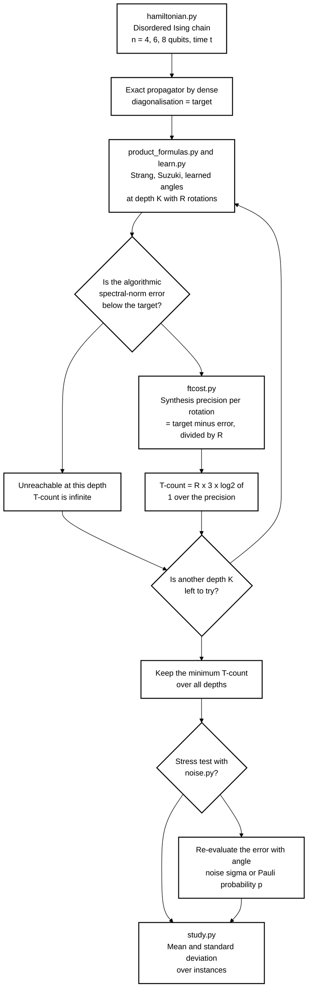
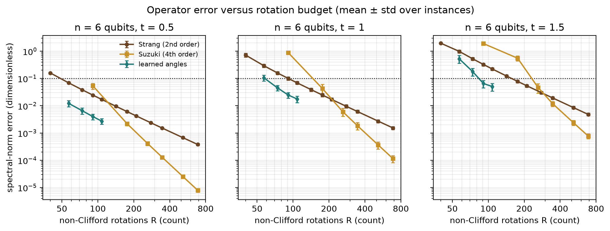
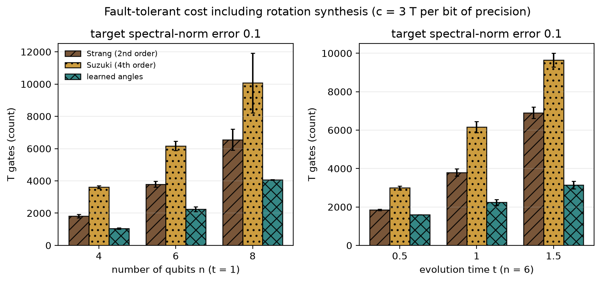
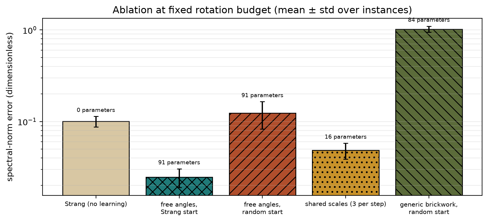
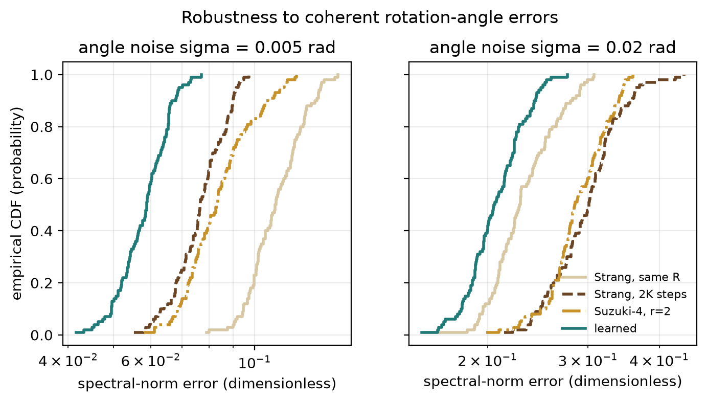
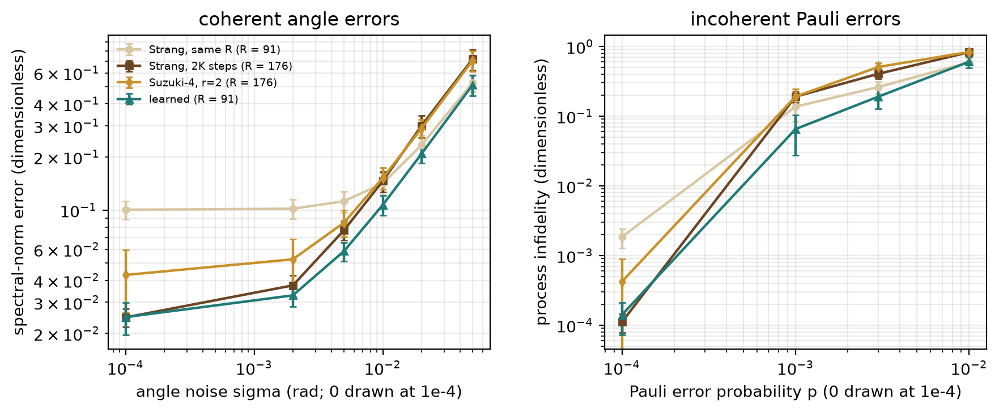

# Learned Trotter Skeletons: Counting T Gates for Compressed Hamiltonian-Simulation Circuits

[](LICENSE)
[](pyproject.toml)
[](https://github.com/pradeepdegalaroyal/learned-trotter-circuits-t-count-synthesis-budget/actions/workflows/ci.yml)

**Research question.** If the angles of a product-formula circuit are learned instead of prescribed, does the circuit still need fewer T gates than Strang and Suzuki formulas once every rotation is charged for the precision with which it must be synthesised into Clifford+T gates?

**Short answer (simulation, 4-8 qubits).** Yes, for moderate accuracy targets. At equal rotation count the learned circuits have 3.2 to 8.6 times lower spectral-norm error, and at a total error target of 0.1 they need 1.61 to 2.19 times fewer T gates for evolution times t of 1 or more. The advantage shrinks to 1.16 times at t = 0.5, reverses (0.85 times) for a loose target of 0.2 at t = 0.5, and is untested for tight accuracy targets because learned depths stop at six layers.

## Abstract

Quantum simulation is the leading candidate for early practical advantage on error-corrected machines, yet product formulas are costly in non-Clifford rotations, and recent work learns compact circuits for operators without costing them in fault-tolerant gates. This study learns every angle of a Strang-shaped circuit for the propagator of a disordered mixed-field Ising chain (4, 6 and 8 qubits, exact dense simulation), and compares it with Strang and Suzuki formulas at equal rotation count and at equal synthesis-inclusive T-count, under angle noise and Pauli noise, with an ablation of parameterisation and initialisation. Learned angles lower the error 3.2-8.6 times at equal rotation count and the T-count 1.61-2.19 times at error target 0.1, but the benefit is confined to shallow depths, depends on the Strang initialisation and costs a dense classical fit that grows to 46.6 s per circuit at 8 qubits.

## Motivation

Digital quantum simulation on fault-tolerant hardware is expected to deliver the first practical advantage (Daley et al., 2022). On such hardware, arbitrary-angle rotations are the expensive resource: each must be compiled into Clifford and T gates, and the non-Clifford overhead dominates (Campbell et al., 2017). Product formulas pay for accuracy with more rotations. Learning circuits for operators by back-propagation has been reported to improve the resource scaling over Suzuki-Trotter expansions (Over et al., 2026), but circuit size there is counted in continuous-angle gates. Whether the gain survives when the cost is the number of T gates after synthesis is the question addressed here.

## Research gap

Related work (all papers are from the supplied literature; each is cited by digital object identifier (DOI)):

| Paper | Year | Role | What it does | What it does not cover |
|---|---|---|---|---|
| Over et al., 10.1088/2058-9565/aeb3b0 | 2026 | recent | Learns circuits for propagators, better scaling than Suzuki-Trotter | T-count after synthesis; rotation-error robustness; source of the gain |
| Lee, English, Bartlett, 10.1038/s41534-026-01242-x | 2026 | recent | Post-selection for quantum low-density parity-check (QLDPC) codes | Cost of the logical circuit being protected |
| Duriez et al., 10.1038/s41524-026-02059-0 | 2026 | recent | Sample-based quantum diagonalisation on hardware for band gaps | Fault-tolerant resource accounting |
| Shayegan, 10.1038/s41598-026-40910-y | 2026 | recent | Compares variational, Harrow-Hassidim-Lloyd and annealing linear solvers | Learned circuits; T-count |
| Daley et al., 10.1038/s41586-022-04940-6 | 2022 | landmark | Roadmap to practical advantage in simulation | Gate-level cost of compression |
| Campbell, Terhal, Vuillot, 10.1038/nature23460 | 2017 | landmark | Universal gates on error-corrected qubits, non-Clifford overhead | Algorithm-specific compression |
| Moll et al., 10.1088/2058-9565/aab822 | 2018 | landmark | Variational algorithms and error mitigation for near-term devices | Fault-tolerant cost model |
| Liu, Arunachalam, Temme, 10.1038/s41567-021-01287-z | 2021 | landmark | Provable kernel speed-up, robust to sampling error | Learned operator compilation |
| Ballance et al., 10.1103/PhysRevLett.117.060504 | 2016 | landmark | 99.9% two-qubit gate fidelity in trapped ions | Algorithm design |
| Gaebler et al., 10.1103/PhysRevLett.117.060505 | 2016 | landmark | Universal gate set, two-qubit error 8(4)x10^-4 | Algorithm design |
| Wang and Liu, 10.1088/1361-6633/ad7f69 | 2024 | review | Quantum machine learning from noisy intermediate-scale quantum (NISQ) devices to fault tolerance | Concrete T-count comparison of learned and analytic circuits |
| Wintersperger et al., 10.1140/epjqt/s40507-023-00190-1 | 2023 | review | End-user view of neutral-atom hardware | Compilation of learned circuits |

None of these puts learned and analytic circuits on a synthesis-inclusive T-count scale, tests learned circuits against angle or Pauli errors, or separates the contribution of free angles from that of circuit structure. The full argument is in [`docs/RESEARCH_GAP.md`](docs/RESEARCH_GAP.md).

## What is new here

- A T-count comparison that charges each rotation `3 log2(1/precision)` T gates and splits a total error target between algorithmic and synthesis error, for learned and product-formula circuits alike.
- A product-formula skeleton with all angles learned, so rotation count is identical to the Strang circuit and the comparison isolates the effect of the angles.
- An ablation that separates free angles, initialisation, three shared scale factors per step and a generic brickwork circuit, with a pre-stated hypothesis (H4) that is narrowly falsified.
- Robustness sweeps (coherent angle noise, Pauli noise) at equal rotation count and at equal algorithmic error.

## Hypotheses

Fixed before the full runs (details and thresholds in `docs/RESEARCH_GAP.md`; a single-instance pilot only chose the evolution times). Verdicts come from `results/summary.json`, key `hypothesis_checks`.

| Hypothesis | Criterion | Measured | Verdict |
|---|---|---|---|
| H1 equal-rotation accuracy | learned error at least 2x lower than Strang for K = 5, 6, all t at n = 6 | minimum ratio 3.9 | holds |
| H2 synthesis-inclusive cost | at target 0.1, n = 6, t = 1, at least 1.5x fewer T gates than the cheapest product formula | 1.70x (3795 vs 2238 T gates) | holds |
| H3 robustness | Pauli infidelity not above equal-error Strang at every p; angle-noise error within 2x of equal-rotation Strang | holds at every p; maximum ratio 0.98 | holds |
| H4 ablation | shared scales, random start and brickwork each at least 2x worse than the method | 1.96, 5.0 and 41.2 | fails narrowly (shared scales) |

## Method



Legend: K is the number of diagonal layers of the skeleton; R is the number of non-Clifford rotations; T-count is the number of T gates; the learned angles are fitted with the Limited-memory Broyden-Fletcher-Goldfarb-Shanno (L-BFGS) optimiser. The branch from the second decision back to C is the loop over depths.

**System.** Open chain of n qubits, H = sum J_j Z_j Z_{j+1} + sum h^z_j Z_j + sum h^x_j X_j with 25% Gaussian disorder (one seed is one instance); target U = exp(-iHt), t in {0.5, 1.0, 1.5} (units of the mean coupling).

**Circuits.** A Strang skeleton X D X D ... D X with K diagonal layers D (n-1 ZZ and n Z rotations) and K+1 transverse layers X (n rotations) has R = K(3n-1)+n rotations. The Suzuki fourth-order formula uses the same skeleton with K = 5r. The learned circuit keeps the skeleton, frees all R angles and optimises the trace loss 1 - |Tr(U^dag V)|/d from the Strang angles (at most 80 L-BFGS iterations, K = 3-6; K = 5-6 at 8 qubits).

**Baselines.** Standard quantum baseline: Strang and Suzuki product formulas up to K = 40 (R = 686 at n = 6). Classical references: exact diagonalisation (defines the target) and Lanczos propagation of single states (reference only, not cost-commensurate). **Metric:** global-phase-optimised spectral-norm error, computed exactly. **Cost model (assumption, not from the literature):** precision epsilon costs 3 log2(1/epsilon) T gates; errors add, so T = R x 3 x log2(R / (target - error)). Details: [`docs/METHOD.md`](docs/METHOD.md).

## Results

All numbers are mean ± standard deviation over instances (5 instances at n = 4 and at n = 6 with t = 1; 3 otherwise) and come from `results/` (tables from `headline_error_table.csv`, `headline_t_count_table.csv`, `ablation.csv`, `noise_angle.csv`, `noise_pauli.csv`, `summary.json`).

### Accuracy at equal rotation count

| n | t | K | R (rotations) | Strang error | Learned error | Ratio |
|---|---|---|---|---|---|---|
| 4 | 1.0 | 5 | 59 | 0.0612 ± 0.0079 | 0.0071 ± 0.0012 | 8.6 |
| 4 | 1.0 | 6 | 70 | 0.0422 ± 0.0054 | 0.0054 ± 0.0013 | 7.8 |
| 6 | 0.5 | 5 | 91 | 0.0244 ± 0.0019 | 0.0040 ± 0.0010 | 6.1 |
| 6 | 0.5 | 6 | 108 | 0.0169 ± 0.0013 | 0.0027 ± 0.0006 | 6.2 |
| 6 | 1.0 | 5 | 91 | 0.1005 ± 0.0131 | 0.0247 ± 0.0057 | 4.1 |
| 6 | 1.0 | 6 | 108 | 0.0692 ± 0.0090 | 0.0177 ± 0.0046 | 3.9 |
| 6 | 1.5 | 5 | 91 | 0.3261 ± 0.0377 | 0.0651 ± 0.0203 | 5.0 |
| 6 | 1.5 | 6 | 108 | 0.2225 ± 0.0255 | 0.0506 ± 0.0160 | 4.4 |
| 8 | 1.0 | 5 | 123 | 0.1403 ± 0.0218 | 0.0407 ± 0.0037 | 3.4 |
| 8 | 1.0 | 6 | 146 | 0.0966 ± 0.0149 | 0.0302 ± 0.0034 | 3.2 |

Equivalently, the Strang circuit needs 1.93 times as many rotations (176 versus 91) to reach the learned error at n = 6, t = 1, K = 5 (`summary.json`, `rotation_ratio_at_equal_error`). At t = 1 the Suzuki fourth-order circuit is worse than Strang up to R = 176 (errors 0.887 ± 0.107 at R = 91; 0.0429 ± 0.0184 versus 0.0246 ± 0.0031 at R = 176) and better from R = 346 (0.00185 ± 0.00056 versus 0.00613 ± 0.00078).



*Figure 1. Learned angles sit a factor 3 to 6 below Strang at the same rotation count, but the learned curve ends at K = 6 while Suzuki's steeper curve overtakes Strang beyond roughly 250 rotations and may overtake the learned curve at tight targets.*

### T-count including rotation synthesis

Total spectral-norm error target 0.1; "best product formula" is the cheapest of Strang and Suzuki over all depths (it was Strang in every row).

| n | t | Best product formula (T gates) | Learned (T gates) | Ratio |
|---|---|---|---|---|
| 4 | 1.0 | 1821 ± 123 | 1046 ± 52 | 1.74 |
| 6 | 0.5 | 1856 ± 44 | 1598 ± 9 | 1.16 |
| 6 | 1.0 | 3795 ± 208 | 2238 ± 166 | 1.70 |
| 6 | 1.5 | 6899 ± 363 | 3146 ± 242 | 2.19 |
| 8 | 1.0 | 6556 ± 789 | 4066 ± 33 | 1.61 |

Other targets (mean T gates; learned instances reaching the target in brackets): at target 0.2 the ratio is 1.34 (n = 4, t = 1), 0.85 (n = 6, t = 0.5, learned 1410 versus 1198), 1.53 (n = 6, t = 1), 1.91 (n = 6, t = 1.5) and 1.15 (n = 8, t = 1); at target 0.05 it is 2.08, 1.56, 1.94 and 1.91 for the same rows except n = 6, t = 1.5, where only 2 of 3 learned instances reach 0.05 (learned 4783 versus 11334 on those; no ratio is quoted). Suzuki alone costs 6165 ± 324 T gates at n = 6, t = 1, target 0.1.



*Figure 2. At error target 0.1 the learned circuits need fewer T gates in every configuration, with the largest saving at the longest time (2.19 times at n = 6, t = 1.5) and the smallest at the shortest (1.16 times at t = 0.5).*

### Ablation (n = 6, t = 1, K = 5, 5 instances)

| Arm | Parameters | Rotations | Spectral-norm error | Ratio to the method |
|---|---|---|---|---|
| Free angles, Strang start (method) | 91 | 91 | 0.0247 ± 0.0057 | 1.0 |
| Shared scales, 3 per step | 16 | 91 | 0.0484 ± 0.0096 | 1.96 |
| Strang, no learning | 0 | 91 | 0.1005 ± 0.0131 | 4.06 |
| Free angles, random start | 91 | 91 | 0.1236 ± 0.0410 | 5.0 |
| Generic brickwork, random start | 84 | 84 | 1.0190 ± 0.0772 | 41.2 |



*Figure 3. Per-site freedom roughly halves the error left by three shared scale factors per step, while a random start or a generic brickwork circuit gains nothing in 80 iterations.*

### Robustness (n = 6, t = 1, K = 5; 5 instances x 20 angle draws, 5 instances x 40 Pauli trajectories)

Arms: learned (R = 91), Strang with the same R, Strang with 2K steps (R = 176, about the same algorithmic error) and Suzuki fourth order with r = 2 (R = 176).

Spectral-norm error under coherent angle noise (standard deviation sigma per rotation, radians):

| Arm | sigma = 0 | 0.005 | 0.02 | 0.05 |
|---|---|---|---|---|
| Learned | 0.0247 ± 0.0051 | 0.0586 ± 0.0071 | 0.2083 ± 0.0242 | 0.5134 ± 0.0673 |
| Strang, same R | 0.1005 ± 0.0118 | 0.1123 ± 0.0151 | 0.2334 ± 0.0312 | 0.5263 ± 0.0571 |
| Strang, 2K steps | 0.0246 ± 0.0028 | 0.0770 ± 0.0096 | 0.3003 ± 0.0424 | 0.7196 ± 0.0973 |
| Suzuki, r = 2 | 0.0429 ± 0.0165 | 0.0849 ± 0.0146 | 0.2904 ± 0.0347 | 0.7054 ± 0.0944 |

Process infidelity under Pauli noise (probability p per rotation):

| Arm | p = 0 | 0.001 | 0.003 | 0.01 |
|---|---|---|---|---|
| Learned | 0.0001 ± 0.0001 | 0.0651 ± 0.0379 | 0.1901 ± 0.0628 | 0.6027 ± 0.1102 |
| Strang, same R | 0.0018 ± 0.0006 | 0.1366 ± 0.0520 | 0.2611 ± 0.0486 | 0.5899 ± 0.0992 |
| Strang, 2K steps | 0.0001 ± 0.0000 | 0.1901 ± 0.0335 | 0.4045 ± 0.0645 | 0.8255 ± 0.0397 |
| Suzuki, r = 2 | 0.0004 ± 0.0005 | 0.1909 ± 0.0539 | 0.5070 ± 0.0767 | 0.8311 ± 0.0806 |



*Figure 4. Under angle noise the empirical cumulative distribution function (ECDF) of the learned circuit's error lies to the left of all other arms, and the gap to same-R Strang closes as sigma approaches 0.05.*



*Figure 5. Learned circuits inherit no extra fragility: with the same rotations as Strang they match it under heavy noise, and with fewer rotations than the equal-error product formulas they lose less.*

### Classical reference and training cost

Lanczos propagation of random product states reaches state error 0.0113 ± 0.0042 with 12 matrix-vector products; the learned circuit has state error 0.0109 ± 0.0024 with 91 rotations (`classical_krylov_reference.csv`; these costs are not commensurate and are listed for orientation only). The classical fit of one learned circuit takes 3.4 s (n = 4), 7.0 s (n = 6) and 46.6 s (n = 8) on average on one central processing unit (CPU) thread (`summary.json`, `fit_seconds_by_n`).

## Discussion

The learned angles do what the hypotheses stated: at the same rotation count they remove a factor 3.2-8.6 of error, and after synthesis the saving is 1.6-2.2 times in T gates at target 0.1 when t is 1 or more. The saving is smaller than the error ratio because the T-count depends only logarithmically on the synthesis budget; most of the benefit comes from needing fewer rotations (about 1.9 times at n = 6, t = 1).

Negative and qualified findings: (i) At t = 0.5 and loose targets the advantage vanishes (1.16 times at target 0.1; learned loses, 0.85 times, at target 0.2), partly because the learned grid starts at K = 3 while Strang can use K = 2. (ii) H4 fails narrowly: three shared scale factors per step already recover a factor 2.1 of the factor 4.1 gained by free angles, and the ratio of 1.96 is just under the pre-stated 2. (iii) The gain needs the product-formula start: a random start (0.1236 ± 0.0410) is no better than not learning (0.1005 ± 0.0131), and a generic brickwork circuit with a comparable number of rotations ends at error about 1 in the 80 iterations allowed, so this is evidence about the optimiser budget as much as about expressivity. (iv) The learned error grows with time at fixed depth (K = 6, n = 6: 0.0027, 0.0177, 0.0506 for t = 0.5, 1, 1.5), consistent with a finite depth limiting how far correlations can spread. (v) Under Pauli noise at the same rotation count the learned and Strang circuits are statistically indistinguishable at p = 0.01 (0.6027 versus 0.5899) and differ by about one standard deviation at p = 0.001 and 0.003, so the lower infidelity at equal rotation count is not resolved; the clear result is against the equal-error circuits with more rotations.

## Limitations

- Simulation only, 4-8 qubits with dense operators; no quantum advantage is claimed or implied, since every target is classically available.
- The classical fit uses the full 2^n x 2^n target and costs 46.6 s per circuit at n = 8; scaling to larger systems needs a different training signal (see Future work).
- The T-count model is an assumption (3 T gates per bit of rotation precision, additive error bound); it ignores Clifford-angle savings and uses the same worst-case bound for every method.
- Learned depths stop at K = 6, so accuracy targets below about 0.02 are not covered; Suzuki's error falls faster with rotations and probably overtakes the learned curve at tight targets (Figure 1).
- 3 to 5 instances per setting; at n = 6, t = 1.5 and target 0.05 one learned instance does not reach the target. One Hamiltonian family and three evolution times were studied.
- The Pauli model applies errors at the end of each layer rather than after each gate and uses 40 trajectories per instance.

## Future work

- Learn translation-invariant or low-rank angle patterns on small chains and transfer them to larger ones, or train against matrix-product-operator targets, to remove the dense classical bottleneck.
- Replace the cost model by an explicit Clifford+T synthesis and add a T-count term to the loss, so the optimiser trades accuracy for synthesis cost directly.
- Fit with a measured hardware noise model, and combine with logical-error budgeting for error-corrected codes (for example, post-selection as in Lee et al., 2026) in the setting of a fault-tolerant algorithms group's resource-estimation toolchain.
- Extend from spin chains to chemistry propagators and to non-unitary operators, as in Over et al., 2026.

## Related work by the author

- [`noise-aware-mpdo-bond-dimension-trotter-quench`](https://github.com/pradeepdegalaroyal/noise-aware-mpdo-bond-dimension-trotter-quench): noise-aware tensor-network simulation of a Trotterised Ising quench.
- [`commuting-qaoa-line-compiler-noise-budget`](https://github.com/pradeepdegalaroyal/commuting-qaoa-line-compiler-noise-budget): how much of a variational algorithm's noise budget is a compiler decision.

## Reproducibility

```bash
pip install -r requirements.txt && pip install -e . --no-deps
pytest -q                               # 10 tests, about 15 s
python experiments/run_all.py           # full study, writes results/ and figures/
python experiments/run_all.py --quick   # smoke run in a temporary folder
python experiments/run_all.py --plots-only   # redraw figures and headline tables from results/
```

The full run took 399.7 s wall-clock on 4 worker processes with one thread each (Windows 11, Python 3.11.9, 16-thread CPU; the graphics processing unit was not used). Dependencies are pinned in `requirements.txt`; continuous integration (CI) runs the tests and the quick run on ubuntu-latest with CPU-only torch.

## Project structure

```
src/learned_trotter/   hamiltonian, circuits (dense layered simulator), product_formulas,
                       learn (L-BFGS fit), metrics, ftcost, krylov, study (tasks, aggregation), plots
experiments/run_all.py one-command reproduction (--quick, --plots-only)
tests/                 unit tests (unitarity, convergence order, metrics, cost model, noise, Lanczos)
docs/                  RESEARCH_GAP.md, METHOD.md
results/               CSV and JSON outputs, trained angles (learned_parameters.json)
figures/               fig1-fig5 at 200 dpi
```

## Citation

```bibtex
@software{degala_learned_trotter_2026,
  author  = {Degala, Chenchupradeep},
  title   = {Learned Trotter Skeletons: Counting T Gates for Compressed Hamiltonian-Simulation Circuits},
  year    = {2026},
  version = {0.1.0},
  url     = {https://github.com/pradeepdegalaroyal/learned-trotter-circuits-t-count-synthesis-budget},
  license = {MIT}
}
```

MIT license (`LICENSE`). Machine-readable citation metadata: `CITATION.cff`.
